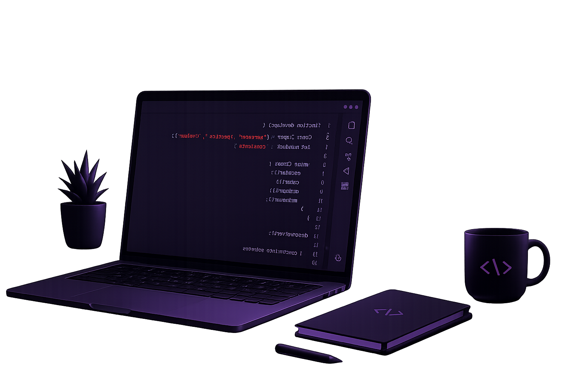

### Olá, meu nome é Fabio! 🤙🏽

### 🎓 Formação acadêmica

**Em andamento**

📚 Análise e Desenvolvimento de Sistemas — FATEC Guaratinguetá

**Concluído**

📚 Gestão da Tecnologia da Informação — UniCesumar

### Sobre mim
Sou estudante de Tecnologia da Informação, interessado em desenvolvimento de software, especialmente nas áreas de Backend, Full Stack e automação.

Possuo experiência prática em infraestrutura de redes, com atividades relacionadas a cabeamento estruturado, organização de racks e instalação de equipamentos de rede.

Atualmente, estou ampliando meus conhecimentos em engenharia de software, lógica de programação e desenvolvimento de aplicações, utilizando JavaScript e Python.

### 🚀 Tecnologias e conhecimentos

**Estudando e praticando:**

- JavaScript
- Python
- HTML e CSS
- Git e GitHub

<h3>Minhas Skills</h3>

  

**Conhecimentos em infraestrutura:**

- Redes de computadores

- Cabeamento estruturado

- Equipamentos de rede

- Access Points e infraestrutura Wi-Fi

### 📂 Projetos

**Desenvolvimento de sistemas:**

**Controle de Estoque — Recanto Nordestino:** projeto acadêmico voltado ao gerenciamento e controle de estoque.

**Painel de Produtividade:** projeto pessoal em desenvolvimento.

**Infraestrutura de redes:**

- **Implantação de infraestrutura de redes — C&A:** 
  Atuação no projeto de infraestrutura de redes do Centro de Distribuição (CD) da C&A, em Navegantes/SC.

- **Projeto de modernização da rede Wi-Fi — Cisco:**
  Participação no projeto de substituição de mais de 3.000 pontos de acesso (Access Points) Cisco.

<h3>Entre em contato</h3>

Entre em contato comigo através dos canais abaixo:

